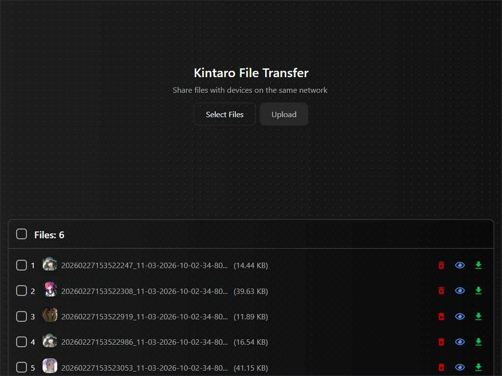

<a href="README.md">
  
</a>
<a href="README-TR.md">
  
</a>

  <br />
  <br />

<div align="center">
  
  <br />
  <br />

  <p>
     Cihazlar arasında Wi-Fi üzerinden dosya aktaran web tabanlı bir araç.
  </p>


  <p>
    <a href="#about">Hakkında</a> •
    <a href="#features">Özellikler</a> •
    <a href="#tech">Teknolojiler</a> •
    <a href="#setup">Kurulum</a> •
    <a href="#gallery">Galeri</a> •
    <a href="#license">Lisans</a>
  </p>

  <br />
  <br />
</div>

## <a id="about"></a> 📋 Hakkında

**WiFi File Transfer**, aynı ağdaki cihazlar arasında dosya paylaşmak için hazırlanmış bir web uygulamasıdır. Uygulamayı bilgisayarınızda çalıştırıp telefonunuz gibi başka bir cihazın tarayıcısından açarsınız, böylece kablo ya da bulut hizmeti olmadan dosyaları iki yönde de aktarabilirsiniz.

Backend Express ile yazılmıştır ve dosyaları bilgisayarınızdaki `uploads` klasöründe tutar. Arayüz ise React ve kendi [Kintaro UI](https://github.com/xkintaro/kintaro-ui) kütüphanemle hazırlanmıştır.

## <a id="features"></a> ✨ Özellikler

- **Çoklu yükleme**: Birçok dosyayı tek seferde seçip yükleyin ve ilerlemesini takip edin.
- **Temiz dosya adları**: Dosya adlarındaki Türkçe karakterler ve geçersiz semboller temizlenir, adlara yükleme zamanı eklenir.
- **Tarayıcıda önizleme**: Görselleri, videoları, ses dosyalarını, PDF'leri ve metin dosyalarını doğrudan tarayıcıda açın. Görseller listede küçük önizlemeler olarak da gösterilir.
- **Toplu işlemler**: Birden fazla dosya seçip tarihli bir ZIP arşivi olarak indirin ya da silin.
- **Tekli dosya işlemleri**: Herhangi bir dosyayı tek tıkla indirin ya da silin.

## <a id="tech"></a> 🛠️ Teknolojiler

`React` · `Vite` · `Kintaro UI` · `React Icons` · `CSS` · `Node.js` · `Express` · `Multer` · `Archiver`

## <a id="setup"></a> 🚀 Kurulum

### Gereksinimler

- **Node.js 18 veya üzeri**

### Adım Adım Kurulum

1. **Depoyu klonlayın**

   ```bash
   git clone https://github.com/xkintaro/wifi-file-transfer.git
   cd wifi-file-transfer
   ```

2. **Bağımlılıkları yükleyin**

   ```bash
   cd backend
   npm install
   cd ../frontend
   npm install
   ```

   Windows'ta bunun yerine `install-dependencies.bat` dosyasını çalıştırabilirsiniz.

3. **Ortam ayarlarını kontrol edin**

   Portlar ve API adresi `.env` dosyalarında ayarlanır.

   **backend/.env**

   ```
   VITE_BACKEND_PORT=5077
   ```

   **frontend/.env**

   ```
   VITE_FRONTEND_API_URL=http://localhost:5077
   VITE_FRONTEND_PORT=5076
   ```

   Uygulamayı başka bir cihazdan kullanmak için `VITE_FRONTEND_API_URL` içindeki `localhost` yerine bilgisayarınızın yerel IP adresini yazın, örneğin `http://192.168.1.10:5077`.

4. **Backend'i ve frontend'i başlatın**

   Her birini ayrı bir terminalde başlatın.

   ```bash
   cd backend
   node index.js
   ```

   ```bash
   cd frontend
   npm run dev
   ```

   Windows'ta bunun yerine `run.bat` dosyasını çalıştırabilirsiniz. İkisini arka planda başlatmak için `run-wifi-file-transfer.vbs` dosyasını çalıştırın. Bu dosya uygulamayı `C:\wifi-file-transfer` klasöründen başlatır, bu yüzden kullanmak için projeyi bu klasöre klonlayın. Uygulamanın Windows açılırken otomatik başlaması için `Win+R` tuşlarına basın, `shell:startup` yazın ve açılan klasöre `run-wifi-file-transfer.vbs` dosyasının kısayolunu koyun.

Uygulamayı şu adreste açın: [http://localhost:5076](http://localhost:5076). Başka bir cihazda aynı portu bilgisayarınızın IP adresiyle açın.

## <a id="gallery"></a> 🖼️ Galeri




## <a id="license"></a> 📄 Lisans

Bu proje MIT Lisansı altında lisanslanmıştır. Detaylar için [LICENSE](LICENSE) dosyasına bakabilirsiniz.

#

<p align="center">
  <sub>❤️ Developed by "Mustafa TAŞAL" (kintaro)</sub>
</p>
