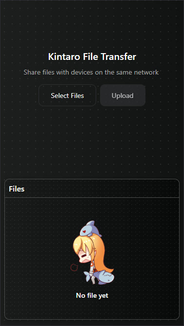

<a href="README.md">
 
</a>
<a href="README-TR.md">
 
</a>

  <br />
  <br />

<div align="center">
  
  <br />
  <br />

  <p>
    Hızlı ve kullanımı kolay, local web tabanlı bir WiFi dosya transfer aracı.
  </p>


  <p>
    <a href="#features">Özellikler</a> •
    <a href="#technologies">Teknolojiler</a> •
    <a href="#installation">Kurulum</a> •
    <a href="#license">Lisans</a> •
    <a href="#gallery">Galeri</a>
  </p>

  <br />
  <br />
</div>

## 📋 Hakkında

**Kintaro WiFi File Transfer**, aynı local ağ üzerindeki cihazlar arasında dosya paylaşımını zahmetsiz hale getirmek için tasarlanmış modern, web tabanlı bir araçtır. Dosyalarınızı bilgisayarınızdan telefonunuza veya tam tersi şekilde taşıyor olun, bu araç kablolara veya harici cloud servislerine gerek duymadan seamless (kesintisiz) bir transfer sağlar.


## <a id="features"></a>✨ Özellikler

### Hızlı WiFi Transferi

Local ağınıza bağlı herhangi bir cihaz arasında dosyaları anında transfer edin. Kablo yok, bluetooth eşleştirmesi yok, sadece WiFi üzerinden tam hız.

### Gelişmiş Dosya Yönetimi

- **Batch Uploads**: Aynı anda birden fazla dosyayı sürükleyip bırakın (drag and drop).
- **Batch Operations**: Birden fazla dosyayı tek bir **ZIP** arşivi olarak indirmek veya toplu silmek için seçin.
- **Auto-Sanitization**: Dosya adları, cross-platform uyumluluğu için Türkçe karakterlerden ve geçersiz sembollerden otomatik olarak temizlenir.

### Kesintisiz Medya Önizleme (Media Preview)

İndirmeden önce dosyalarınızı doğrudan tarayıcıda (browser) görüntüleyin veya dinleyin:

- **Görseller**: `JPG`, `PNG`, `GIF`, `WEBP`
- **Video & Ses**: `MP4`, `WEBM`, `MP3`
- **Dokümanlar**: `PDF`, `TXT` ve `HTML` için built-in destek.

## <a id="technologies"></a>🛠️ Teknolojiler

Proje, modern bir full-stack JavaScript mimarisi kullanmaktadır:

### Frontend

- **React 19**: Son derece responsive bir UI için en son React özellikleri.
- **Vite**: Ultra hızlı build tool ve development server.
- **Axios**: API iletişimi için güçlü bir HTTP client.
- **React Icons**: Şık bir görünüm için kapsamlı icon library.

### Backend

- **Node.js**: Ölçeklenebilir runtime environment.
- **Express**: API için minimalist web framework.
- **Multer**: Multi-part dosya yüklemelerini yönetmek için middleware.
- **Archiver**: Batch indirmeler için on-the-fly ZIP oluşturma.

## 🚀 Kurulum <a id="installation"></a>

Projeyi local environment'ınızda çalıştırmak için aşağıdaki adımları takip edin.

### Gereksinimler

- **Node.js** (v18+)
- **npm**

### Adım Adım Kurulum

1.  **Repository'yi Klonlayın**

    ```bash
    git clone https://github.com/xkintaro/wifi-file-transfer.git
    cd wifi-file-transfer
    ```

2.  **Backend Dependency'lerini Yükleyin**

    ```bash
    cd backend
    npm install
    ```

3.  **Frontend Dependency'lerini Yükleyin**

    ```bash
    cd ../frontend
    npm install
    ```

4.  **Environment Konfigürasyonu**  
    Her iki klasördeki `.env` dosyalarının konfigüre edildiğinden emin olun.

    **backend/.env**

    ```
    VITE_BACKEND_PORT=5077
    ```

    **frontend/.env**

    ```
    VITE_FRONTEND_API_URL=http://localhost:5077
    VITE_FRONTEND_PORT=5076
    ```

5.  **Backend Server'ı Başlatın**

    ```bash
    cd ../backend
    node index.js
    ```

6.  **Frontend Server'ı Başlatın**
    Yeni bir terminal açın:
    ```bash
    cd frontend
    npm run dev
    ```

## 📄 Lisans <a id="license"></a>

Bu proje MIT Lisansı ile lisanslanmıştır. Detaylar için [LICENSE](LICENSE) dosyasını inceleyebilirsiniz.

## 🖼️ Galeri <a id="gallery"></a>



#

<p align="center">
  <sub>❤️ Developed by "Mustafa TAŞAL" (kintaro)</sub>
</p>
