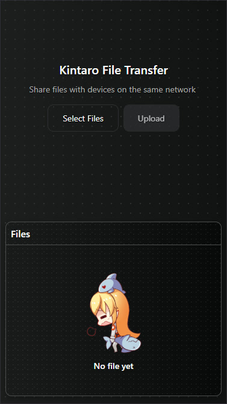

<div align="center">
  
  <br />
  <br />

  [](https://nodejs.org/)
  [](https://expressjs.com/)
  [](https://react.dev/)
  [](https://vitejs.dev/)

  <p align="center">
    <b>Lightweight, Fast and Secure Local Web-Based WiFi File Transfer Tool</b>
    <br />
    <br />
    <a href="#features">Features</a> •
    <a href="#tech">Technologies</a> •
    <a href="#setup">Setup</a>
  </p>
</div>

---

## 📋 About

**Kintaro WiFi File Transfer** is a modern, web-based tool designed to make file sharing effortless between devices on the same local network. Whether you're moving files from your computer to your phone or vice versa, this tool ensures seamless transfer without the need for cables or external cloud services.


## <a id="features"></a>✨ Features

### ⚡ Rapid WiFi Transfer
Transfer files instantly across any device connected to your local network. No cables, no bluetooth pairing, just pure speed over WiFi.

### 🔄 Advanced File Management
- **Batch Uploads**: Drag and drop multiple files at once.
- **Batch Operations**: Select multiple files to download as a single **ZIP** archive or delete them in bulk.
- **Auto-Sanitization**: Filenames are automatically cleaned of Turkish characters and invalid symbols for cross-platform compatibility.

### 🖼️ Seamless Media Preview
View or listen to your files directly in the browser before downloading:
- **Images**: `JPG`, `PNG`, `GIF`, `WEBP`
- **Video & Audio**: `MP4`, `WEBM`, `MP3`
- **Documents**: Built-in support for `PDF`, `TXT`, and `HTML`.



## <a id="tech"></a>🛠️ Technologies

The project utilizes a modern full-stack JavaScript architecture:

### Frontend
- **[React 19](https://react.dev/)**: Latest React features for a highly responsive UI.
- **[Vite](https://vitejs.dev/)**: Ultra-fast build tool and development server.
- **[Axios](https://axios-http.com/)**: Robust HTTP client for API communication.
- **[React Icons](https://react-icons.github.io/react-icons/)**: Comprehensive icon library for a polished look.

### Backend
- **[Node.js](https://nodejs.org/)**: Scalable runtime environment.
- **[Express](https://expressjs.com/)**: Minimalist web framework for the API.
- **[Multer](https://github.com/expressjs/multer)**: Middleware for handling multi-part file uploads.
- **[Archiver](https://www.archiverjs.com/)**: On-the-fly ZIP generation for batch downloads.
- **[Dotenv](https://github.com/motdotla/dotenv)**: Environment variable management.

---

## <a id="setup"></a>🚀 Setup and Installation

Follow these steps to get your local file transfer station up and running:

### Requirements
- **Node.js**
- **npm**

### Step 1: Clone the Repository
```bash
git clone https://github.com/xkintaro/wifi-file-transfer.git
cd wifi-file-transfer
```

### Step 2: Install Dependencies
You can use the provided batch file for quick installation:
```bash
install-dependencies.bat
```
*Or manually run `npm install` in both the `frontend` and `backend` directories.*

### Step 3: Configure Environment
Ensure the ports and upload directories are set in the `.env` files located in both `frontend/` and `backend/` folders.

### Step 4: Run the Application
Start both the frontend and backend servers with a single command:
```bash
run.bat
```
*This will open two terminal windows running the development servers.*

---

<p align="center">
  <sub>❤️ Developed by Kintaro.</sub>
</p>
