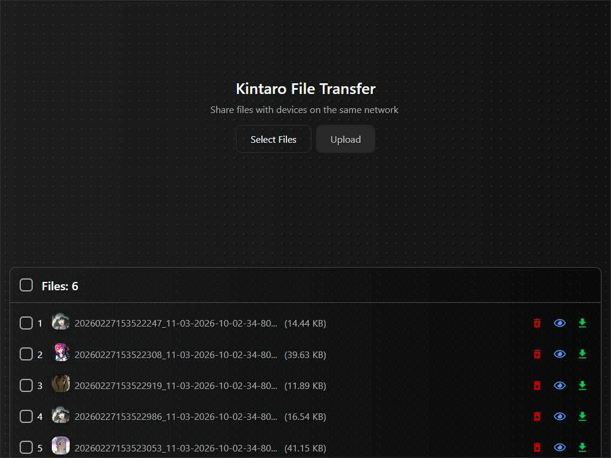

<a href="README.md">
  
</a>
<a href="README-TR.md">
  
</a>

  <br />
  <br />

<div align="center">
  
  <br />
  <br />

  <p>
     A web based tool for transferring files between devices over WiFi.
  </p>


  <p>
    <a href="#about">About</a> •
    <a href="#features">Features</a> •
    <a href="#tech">Tech</a> •
    <a href="#setup">Setup</a> •
    <a href="#gallery">Gallery</a> •
    <a href="#license">License</a>
  </p>

  <br />
  <br />
</div>

## <a id="about"></a> 📋 About

**WiFi File Transfer** is a web application for sharing files between devices on the same network. You run it on your computer and open it in the browser of another device such as your phone, so you can move files in both directions without cables or cloud services.

The backend is built with Express and keeps the files in the `uploads` folder on your computer, and the interface is built with React and my own [Kintaro UI](https://github.com/xkintaro/kintaro-ui) library.

## <a id="features"></a> ✨ Features

- **Multiple uploads**: Select and upload many files at once while following the progress.
- **Clean file names**: Turkish characters and invalid symbols are removed from file names, and the upload time is added to them.
- **In-browser preview**: Open images, videos, audio, PDF and text files directly in the browser. Images are also shown as small previews in the list.
- **Bulk actions**: Select multiple files to download them as a dated ZIP archive or to delete them.
- **Single file actions**: Download or delete any file with a single click.

## <a id="tech"></a> 🛠️ Tech

`React` · `Vite` · `Kintaro UI` · `React Icons` · `CSS` · `Node.js` · `Express` · `Multer` · `Archiver`

## <a id="setup"></a> 🚀 Setup

### Requirements

- **Node.js 18 or newer**

### Step-by-Step Installation

1. **Clone the repository**

   ```bash
   git clone https://github.com/xkintaro/wifi-file-transfer.git
   cd wifi-file-transfer
   ```

2. **Install dependencies**

   ```bash
   cd backend
   npm install
   cd ../frontend
   npm install
   ```

   On Windows you can run `install-dependencies.bat` instead.

3. **Check the environment settings**

   The ports and the API address are set in the `.env` files.

   **backend/.env**

   ```
   VITE_BACKEND_PORT=5077
   ```

   **frontend/.env**

   ```
   VITE_FRONTEND_API_URL=http://localhost:5077
   VITE_FRONTEND_PORT=5076
   ```

   To use the app from another device, replace `localhost` in `VITE_FRONTEND_API_URL` with the local IP address of your computer, such as `http://192.168.1.10:5077`.

4. **Start the backend and the frontend**

   Start each one in its own terminal.

   ```bash
   cd backend
   node index.js
   ```

   ```bash
   cd frontend
   npm run dev
   ```

   On Windows you can run `run.bat` instead.

Open the app at [http://localhost:5076](http://localhost:5076). On another device, open the same port with the IP address of your computer.

## <a id="gallery"></a> 🖼️ Gallery




## <a id="license"></a> 📄 License

This project is licensed under the MIT License. See the [LICENSE](LICENSE) file for details.

#

<p align="center">
  <sub>❤️ Developed by "Mustafa TAŞAL" (kintaro)</sub>
</p>
